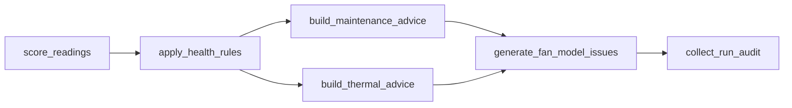

# ClairAI Machine Health Failure-RCA & Model Observability POC

**Final A-to-Z Technical Design, Implementation, Demonstration & Engineering Handover Guide**

> **Author / Lead Presenter:** Ramu Venkatesan | **Target Environment:** Databricks Asset Bundle (`machine_health.prod` / `machine_health.dev`) | **Compute Cluster:** `clairai-model-metrics` (`0828-125833-31m6neog`) | **Bundle:** `clarai_machine_health`

---

## Repository Overview & Quickstart

This repository contains the production implementation of the **ClairAI Machine Health Failure-RCA & Model Observability Proof-of-Concept (POC)**, packaged as a standard Databricks Asset Bundle (`clarai_machine_health`).

### Project Layout

```
clarai_machine_health/
├── databricks.yml                      # DAB bundle configuration (dev & prod targets)
├── README.md                           # Main technical documentation & handover runbook
├── pyproject.toml                      # Project metadata & Python dependencies
├── resources/                          # Databricks Asset Bundle workflow jobs
│   ├── clarai_machine_health_fan.yml          # Fan pipeline (Mon-Wed, fan_v1 baseline)
│   ├── clarai_machine_health_fan_v2.yml       # Fan pipeline (Thu-Sat, fan_v2 candidate)
│   ├── clarai_machine_health_motor.yml        # Motor pipeline (every 6 hrs)
│   ├── clarai_machine_health_motor_weekly_run.yml # Motor weekly run (cron: 0 0 16 ? * TUE,FRI)
│   ├── clairai_machine_health_compressor.yml  # Compressor pipeline (every 5 hrs)
│   ├── clairai_machine_health_compressor_weekly_run.yml # Compressor weekly run (cron: 0 0 16 ? * TUE,FRI)
│   ├── clarai_job_cost_monitoring.yml         # DBU and USD cost tracking pipeline
│   └── sensor_data.yml                        # Synthetic sensor telemetry generation job
│   ├── Databricks Asset Bundle (DAB).docx     # DAB architecture document
│   └── clarai.prod Table Schema Reference.pdf # Unity Catalog schema reference
├── src/                                # Databricks notebooks (.ipynb format)
│   ├── 00_setup.ipynb                         # Catalog, schema & 9 Delta tables DDL
│   ├── common_utils.ipynb                     # Instrumentation, audit context & fault injection
│   ├── score_readings.ipynb                   # Anomaly scoring & dynamic model inference
│   ├── apply_health_rules.ipynb               # Idempotent MERGE into alert_candidates
│   ├── build_maintenance_advice.ipynb         # Vibration inspection recommendations
│   ├── build_thermal_advice.ipynb             # Cooling maintenance recommendations
│   ├── generate_fan_model_issues.ipynb        # Case 3: Reviewer feedback & ClairAI feed
│   ├── collect_run_audit.ipynb                # End-to-end task audit & RCA evidence capture
│   ├── job_cost_monitoring.ipynb              # Billing telemetry aggregation
│   └── synthetic sensor data.ipynb            # Telemetry generator
├── tests/                              # Unit tests & validation fixtures
│   ├── conftest.py                            # Databricks Connect test configuration
│   ├── test_pipeline_helpers.py               # Scope & audit column unit tests
│   └── sample_taxis_test.py                   # Databricks Connect test fixture
└── Documents/                          # Handover documentation
    └── ClairAI_Machine_Health_POC_Final_A_to_Z_Technical_Documentation.md
```

### Essential DAB Commands

| Action | Command |
| :--- | :--- |
| **Validate Bundle (Dev)** | `databricks bundle validate` |
| **Validate Bundle (Prod)** | `databricks bundle validate -t prod` |
| **Deploy Bundle (Dev)** | `databricks bundle deploy -t dev` |
| **Deploy Bundle (Prod)** | `databricks bundle deploy -t prod` |
| **Run Fan Baseline (`fan_v1`)** | `databricks bundle run clarai_machine_health_fan` |
| **Run Fan Candidate (`fan_v2`)** | `databricks bundle run clarai_machine_health_fan_v2` |
| **Run Motor Pipeline** | `databricks bundle run clarai_machine_health_motor` |
| **Run Compressor Pipeline** | `databricks bundle run clairai_machine_health_compressor` |
| **Run Cost Monitoring** | `databricks bundle run clarai_job_cost_monitoring` |
| **Run Synthetic Data Generation** | `databricks bundle run sensor_data` |


<table>
<colgroup>
<col style="width: 100%" />
</colgroup>
<tbody>
<tr class="odd">
<td><strong>DOCUMENT STATUS — FINAL POC BASELINE (UPDATED)</strong><br />
This document describes the implemented Databricks proof of concept, the execution flow, the audit/RCA contract, the two demonstrated failure cases, the cost monitoring extension, and the operational demo/runbook. The active working namespace is machine_health.prod (with clarai.prod supported as handover alias). The original design/test-bench material used plant_demo.machine_health and /Shared paths; those are treated as historical design references, reconciled with the current Databricks Asset Bundle (DAB) implementation.</td>
</tr>
</tbody>
</table>

|                          |                                                                                                          |
|--------------------------|----------------------------------------------------------------------------------------------------------|
| **Attribute**            | **Final POC value**                                                                                      |
| Platform                 | Databricks / Delta Lake / Databricks Jobs / Databricks Asset Bundles (DAB)                               |
| Current catalog/schema   | machine_health.prod / machine_health.dev (handover/legacy alias: clarai.prod)                           |
| Current workspace folder | /Workspace/.bundle/clarai_machine_health/ or /Workspace/ClarAi/MachineHealth/                             |
| Bundle names             | clarai_machine_health; clarai_machine_health_case3                                                       |
| Compute Cluster          | `clairai-model-metrics` (Cluster ID: `0828-125833-31m6neog`)                                             |
| Jobs                     | `clairai_machine_health_compressor`; `clairai_machine_health_compressor_weekly_run`; `clarai_machine_health_motor`; `Clone_of_clarai_machine_health_motor_weekly_run`; `clarai_machine_health_fan`; `clarai_machine_health_fan_v2`; `clarai_job_cost_monitoring`; `sensor_data` |
| Machine families         | Motor; Compressor; Fan                                                                                   |
| Demonstrated cases       | Case 1 — local disk exhaustion; Case 2 — concurrent Delta MERGE; Case 3 — accidental model deployment    |
| Primary RCA/Audit output | pipeline_run_audit; alert_candidates (standardized 13-column issue/review schema)                        |
| Cost monitoring output   | machine_health.prod.pipeline_cost_monitoring; pipeline_cost_summary                                       |
| Audit grain              | One row per task attempt + one row per upstream-skipped task + consolidated issue reviews                |
| Retry behavior           | apply_health_rules: one configured retry; attempt_number uses task execution count                       |
| POC state                | Functional failure-case demonstration, model observability, cost tracking and RCA evidence captured      |
| Lead / Prepared          | Ramu Venkatesan / 31 October 2026                                                                        |

# Document Control & Contents

This is the engineering handover document for the ClairAI machine-health failure/RCA and model observability proof of concept. It is written to be usable by an architect, senior data engineer, operations engineer, or reviewer who did not build the POC.

- 1\. Executive summary

- 2\. Scope, objectives and success criteria

- 3\. Source-of-truth reconciliation

- 4\. End-to-end architecture

- 5\. Data model and table responsibilities

- 6\. Notebook-by-notebook implementation

- 7\. Job orchestration and execution semantics

- 8\. Audit and ClairAI exchange contract

- 9\. Case 1 — library installation / disk exhaustion

- 10\. Case 2 — concurrent Delta MERGE

- 11\. Case 3 — accidental model deployment (ClairAI model observability)

- 12\. RCA and observability decision logic

- 13\. Validation and demonstrated evidence

- 14\. Demo runbook — clean run, failure modes and model observability

- 15\. Recovery and troubleshooting

- 16\. Production hardening recommendations

- 17\. Final acceptance checklist

- Appendix A — Final audit-table schema

- Appendix B — Current setup DDL

- Appendix C — Current collect_run_audit implementation

- Appendix D — Current job bundle

- Appendix E — Evidence screenshots and source references

- Appendix F — Cost Monitoring Pipeline

# 1. Executive Summary

The ClairAI Machine Health POC demonstrates an operationally realistic Databricks pipeline that not only produces machine-health outputs but also captures the execution and model behavior evidence required to explain failures. The design deliberately separates business data (sensor readings, predictions, decisions and recommendations) from execution metadata (job/task identity, attempt, status, error, compute, URLs, concurrency evidence and human review metrics).

Three critical operational failure modes are implemented, demonstrated, and verified:

1. **Case 1 (Local Disk Exhaustion):** A controlled disk-exhaustion hook forces a Python package installation to fail with `[Errno 28] No space left on device` before scoring completes. Blocked downstream tasks are recorded with explicit `UPSTREAM_FAILED` audit records.
2. **Case 2 (Concurrent Delta MERGE):** Motor and Compressor jobs concurrently write to the unpartitioned `health_decisions` Delta table. One MERGE loses the optimistic-concurrency race, records authoritative `conflicting_version` and `conflicting_job_run_id` history, and successfully recovers on retry.
3. **Case 3 (Accidental Model Deployment & Model Observability):** For the **Fan** asset family, an unapproved, oversensitive candidate model (`fan_v2`) is deployed to production instead of the approved baseline (`fan_v1`). It triggers a 3x false alarm volume surge (~15 to ~46 issues/day) and a **40.2 percentage-point collapse in operator acceptance (82.5% down to 42.3%)**. ClairAI Model Observability isolates the dominant rejection cause (**ModelOversensitive, 45.6%** of rejections) across a 48-hour SLA review buffer and raises a **High-Severity Alert (`ModelAcceptanceRateDip`)** with 1-click Databricks Job and MLflow rollback links.

<table>
<colgroup>
<col style="width: 100%" />
</colgroup>
<tbody>
<tr class="odd">
<td><strong>ENGINEERING OUTCOME</strong><br />
The POC proves the central ClairAI principle: RCA and operational decisions must be derived from authoritative execution and reviewer feedback evidence, not timing guesses. For Case 1 the evidence is task-level OS errors. For Case 2 it is Delta history commit metadata. For Case 3 it is human review decisions consolidated in alert_candidates with direct MLflow lineage.</td>
</tr>
</tbody>
</table>

# 2. Scope, Objectives and Success Criteria

## 2.1 Scope

- Databricks-based machine-health processing for Motor, Compressor, and Fan (with Model Observability).

- Raw sensor fixture → scoring → health decision MERGE → candidate generation → maintenance and thermal advice.

- Task-level audit instrumentation and post-run enrichment through the Databricks Jobs API.

- Controlled reproduction of disk-exhaustion and concurrent-write failure modes.

- Evidence suitable for downstream ClairAI RCA ingestion.

## 2.2 Explicit non-goals

- Real customer sensor data or production ML models.

- Rebuilding the upstream EMR/S3 production ingestion layer.

- Implementing every production KCF controller stage.

- Inferring a competing job when the platform does not provide authoritative conflict evidence.

## 2.3 Success criteria

|                      |                                                                                                                      |
|----------------------|----------------------------------------------------------------------------------------------------------------------|
| **Criterion**        | **Acceptance condition**                                                                                             |
| Clean execution      | All normal tasks complete successfully and expected output tables are populated.                                     |
| Case 1               | A task fails with \[Errno 28\] No space left on device; blocked downstream tasks are represented as UPSTREAM_FAILED. |
| Case 2               | The first apply_health_rules attempt fails with a concurrent Delta error and a retry succeeds.                       |
| Audit completeness   | Every executed task attempt has its own audit row; skipped tasks receive explicit upstream-failed records.           |
| RCA evidence         | Job/task URLs, compute identity and failure-specific evidence are retained.                                          |
| Concurrency evidence | read_version, conflicting_version and conflicting_job_run_id are retained when the conflict is captured.             |

# 3. Source-of-Truth Reconciliation

The original ClairAI failure-case specification and test-bench document were written with generic names such as plant_demo.machine_health and /Shared/machine_health_demo/. The implemented POC was subsequently organized under the Databricks Asset Bundle (DAB) architecture using the machine_health.prod catalog/schema (and clarai.prod as a production/handover namespace), executed from /Workspace/.bundle/clarai_machine_health/ or /Workspace/ClarAi/MachineHealth/. The failure semantics and audit contract remain the same.

|                              |                                                                                                       |
|------------------------------|-------------------------------------------------------------------------------------------------------|
| **Design reference**         | **Current implementation**                                                                            |
| plant_demo.machine_health    | machine_health.prod (alias: clarai.prod)                                                              |
| /Shared/machine_health_demo/ | /Workspace/.bundle/clarai_machine_health/ or /Workspace/ClarAi/MachineHealth/                         |
| Job identities               | clairai_machine_health_motor, clairai_machine_health_compressor (legacy: machine_health_motor_job)    |
| Cost monitoring job          | clairai_job_cost_monitoring                                                                           |
| retry / retry_count concept  | task.execution_count → attempt_number                                                                 |
| Generic task names           | score_readings, apply_health_rules, build_maintenance_advice, build_thermal_advice, collect_run_audit |
| Generic family examples      | Motor, Compressor                                                                                     |
| Original audit core fields   | Core fields retained and enriched with workspace_id, job_name, asset_type                             |

This reconciliation is important for handover: the original design describes intent; the current implementation values above describe the actual POC baseline.

# 4. End-to-End Architecture

At a high level, the POC is a small DAG with one shared Delta decision table. The shared table is intentionally unpartitioned and has deletion vectors disabled because reproducible write contention is a core test objective.

**Logical pipeline flow**


|                          |                                                               |                                          |
|--------------------------|---------------------------------------------------------------|------------------------------------------|
| **Component**            | **Purpose**                                                   | **Primary output**                       |
| sensor_readings_raw      | Small deterministic sensor fixture                            | Input measurements                       |
| ingest_watermark         | Prevents reprocessing of already consumed reading_time values | Per-machine watermark                    |
| score_readings           | Scores new readings using deterministic vibration rule        | predictions_latest / predictions_history |
| apply_health_rules       | Applies decision rules and performs shared MERGE              | health_decisions / alert_candidates      |
| build_maintenance_advice | Converts unhealthy vibration evidence into maintenance action | maintenance_advice                       |
| build_thermal_advice     | Creates cooling advice for unhealthy and hot machines         | thermal_advice                           |
| collect_run_audit        | Enriches execution evidence and adds skipped-task rows        | pipeline_run_audit                       |

# 5. Data Model and Table Responsibilities

|                          |                                |                                                                         |
|--------------------------|--------------------------------|-------------------------------------------------------------------------|
| **Table**                | **Role**                       | **Key behavior**                                                        |
| sensor_readings_raw      | Raw machine-health fixture     | Motor/Compressor/Fan readings with vibration, accel, and temperature    |
| ingest_watermark         | Incremental processing control | Stores last processed reading_time by machine_type                      |
| predictions_latest       | Current prediction state       | Scoped overwrite by machine_type                                        |
| predictions_history      | Prediction history             | Append-only history of scoring results                                  |
| health_decisions         | Shared decision state          | MERGE target used by both jobs; primary concurrency test surface        |
| alert_candidates         | Unified alerts & issue reviews | Idempotent MERGE; stores human reviews, MLflow lineage & rejection categorization |
| maintenance_advice       | Maintenance recommendations    | Anti-join prevents duplicate advice rows                                |
| thermal_advice           | Thermal recommendations        | Anti-join prevents duplicate advice rows                                |
| pipeline_run_audit       | Execution/RCA evidence         | One row per attempt plus skipped-task evidence                          |
| pipeline_cost_monitoring | Run-level cost tracking        | Estimated DBU usage and USD cost per job run; partitioned by usage_date |
| pipeline_cost_summary    | Cost rollup                    | Aggregated cost and run counts per job                                  |

## 5.1 Deterministic scoring rule

The POC intentionally avoids model variability. A vibration_rms_mm_s value above 0.5 is classified as unhealthy (is_healthy = 0); otherwise it is healthy (is_healthy = 1). The model_tag is derived from the machine family and the model version (`fan_v1`, `fan_v2`, etc.).

## 5.2 Advice logic

- Maintenance: unhealthy candidate + vibration evidence → category HIGH_VIBRATION → Schedule inspection.

- Thermal: unhealthy decision + temp_c \> 80°C → Check cooling.

- Both advice tables use anti-join style de-duplication so repeated runs do not blindly duplicate existing recommendations.

## 5.3 Standardized 13-column schema for alert_candidates

To avoid catalog clutter while supporting full Model Observability and backward compatibility with Motor and Compressor pipelines, issue tracking and reviewer feedback are consolidated into `alert_candidates`:

```sql
CREATE OR REPLACE TABLE alert_candidates (
  issue_id        STRING,    -- Unique identifier (e.g. ISS-F-1001, ISS-F-2001)
  sensor_id       STRING,    -- Sensor identifier (FAN-001, FAN-002)
  machine_type    STRING,    -- Asset family (Fan, Motor, Compressor)
  reading_time    TIMESTAMP, -- Timestamp of anomaly
  axis            STRING,    -- Measurement axis (X, Y, Z)
  is_healthy      BIGINT,    -- 0 = Anomaly / Unhealthy, 1 = Healthy
  model_tag       STRING,    -- Model version (fan_v1 vs fan_v2)
  decision_note   STRING,    -- Rule reason (rule_flagged)
  status          STRING,    -- 'Open' (Accepted), 'Removed' (Rejected), 'New' (In Review)
  removal_reason  STRING,    -- ModelOversensitive, EquipmentIsHealthy, DuplicateIssue, SensorGlitch
  mlflow_run_id   STRING,    -- Clean 32-character MLflow Run ID hash
  job_id          STRING,    -- Databricks Job ID (745174521807184 / 412902752913879)
  job_run_id      STRING     -- Databricks Job Run ID
);
```

# 6. Notebook-by-Notebook Implementation

All pipeline logic is implemented in Databricks Jupyter notebook format (`.ipynb`) in `src/`, running on cluster `clairai-model-metrics` (`0828-125833-31m6neog`):

| Notebook Path | Responsibility | Layer |
| :--- | :--- | :--- |
| `src/00_setup.ipynb` | Creates catalog/schema and all 9 Delta tables (including standardized 13-column `alert_candidates`); seeds deterministic Motor and Compressor rows. | Foundation / DDL |
| `src/common_utils.ipynb` | Shared widgets, metadata resolution, audit context manager, disk-fault injection (`inject_fault`), and common constants (`COLS`). | Cross-cutting Utility |
| `src/score_readings.ipynb` | Reads sensor telemetry past the watermark, applies deterministic anomaly scoring, dynamically supports `model_version` (`fan_v1` vs `fan_v2`), and writes predictions. Can trigger Case 1 disk fault. | Scoring & Inference |
| `src/apply_health_rules.ipynb` | Reads predictions, optionally delays the source (`merge_delay_sec`) for Case 2 overlap, captures Delta read version, executes idempotent Delta MERGE into `alert_candidates`. | Decision & Concurrency |
| `src/build_maintenance_advice.ipynb` | Generates `HIGH_VIBRATION` maintenance advice from alert candidates and vibration evidence via anti-join. | Advice & Recommendation |
| `src/build_thermal_advice.ipynb` | Generates `Check cooling` advice for unhealthy records whose operating temperature exceeds 80°C. | Advice & Recommendation |
| `src/generate_fan_model_issues.ipynb` | Case 3 Fan Model Observability: Generates issue reviews, attaches MLflow run IDs (`bb1b3a15...` vs `843a6a49...`), simulates 48-hr SLA buffer, and emits `ModelOversensitive` rejections. | Observability & Telemetry |
| `src/collect_run_audit.ipynb` | Runs with `run_if: ALL_DONE`, captures task run telemetry, resolves Databricks Jobs API parent/competing run metadata, and logs `UPSTREAM_FAILED` rows. | Audit & RCA Engine |
| `src/job_cost_monitoring.ipynb` | Queries `system.billing.usage` to aggregate DBU usage and calculate USD pipeline operational costs across all machine health jobs. | Cost & FinOps |
| `src/synthetic sensor data.ipynb` | Generates realistic synthetic vibration, acceleration, and temperature telemetry for Fan, Motor, and Compressor assets. | Telemetry Generator |

## 6.1 Important implementation principle

The audit row is written inside the task execution context, including the failure path. This is the critical design choice that preserves a failed attempt rather than relying only on the final Databricks job state.

# 7. Job Orchestration and Execution Semantics

| Job Name | Machine Type | Schedule / Cron | Concurrency | Cluster | Operational Role & Special Behavior |
| :--- | :--- | :--- | :--- | :--- | :--- |
| `clairai_machine_health_compressor` | Compressor | `0 0 */5 * * ?` (Every 5 hrs, UTC) | `max_concurrent_runs = 1` | `clairai-model-metrics` | Primary Compressor pipeline; competing writer in Case 2. |
| `clairai_machine_health_compressor_weekly_run` | Compressor | `0 0 16 ? * TUE,FRI` (IST) | `max_concurrent_runs = 1` | `clairai-model-metrics` | Scheduled bi-weekly maintenance & health scoring for Compressor. |
| `clarai_machine_health_motor` | Motor | `0 0 */6 * * ?` (Every 6 hrs, UTC) | `max_concurrent_runs = 1` | `clairai-model-metrics` | Primary Motor pipeline; delayed writer in Case 2 (`merge_delay_sec=30`), Case 1 target. |
| `Clone_of_clarai_machine_health_motor_weekly_run` | Motor | `0 0 16 ? * TUE,FRI` (IST) | `max_concurrent_runs = 1` | `clairai-model-metrics` | Scheduled bi-weekly maintenance & health scoring for Motor. |
| `clarai_machine_health_fan` | Fan | `0 10 9 ? * MON,TUE,WED` (UTC) | `max_concurrent_runs = 1` | `clairai-model-metrics` | Approved baseline (`fan_v1`, 82.5% acceptance); Job ID `745174521807184`. |
| `clarai_machine_health_fan_v2` | Fan | `0 10 9 ? * THU,FRI,SAT` (UTC) | `max_concurrent_runs = 1` | `clairai-model-metrics` | Unapproved candidate (`fan_v2`, 42.3% acceptance, 3x alert volume); Job ID `412902752913879`. |
| `clarai_job_cost_monitoring` | Cross-asset | `0 0 6 * * ?` (Daily 06:00 UTC) | `max_concurrent_runs = 1` | `clairai-model-metrics` | Aggregates `system.billing.usage` over 7-day lookback for all machine health jobs. |
| `sensor_data` | Synthetic Telemetry | `0 0 0/4 * * ?` (Every 4 hrs, IST) | `max_concurrent_runs = 1` | `clairai-model-metrics` | Generates continuous sensor readings across all asset families. |

**Task dependency semantics**

- **Motor & Compressor (5 tasks):** `score_readings` → `apply_health_rules` (1 retry) → `build_maintenance_advice` & `build_thermal_advice` → `collect_run_audit` (`run_if: ALL_DONE`).
- **Fan Pipeline (6 tasks):** `score_readings` → `apply_health_rules` → `build_maintenance_advice` & `build_thermal_advice` → `generate_fan_model_issues` → `collect_run_audit`.




apply_health_rules is configured with one retry. The current implementation uses task.execution_count as the attempt signal rather than the unsupported retry_count expression encountered during validation.

<table>
<colgroup>
<col style="width: 100%" />
</colgroup>
<tbody>
<tr class="odd">
<td><strong>WHY collect_run_audit USES ALL_DONE</strong><br />
A failure pipeline must still produce an evidence package. If a task fails and downstream tasks are skipped, collect_run_audit must execute so the audit table records the parent run, URLs and explicit UPSTREAM_FAILED rows.</td>
</tr>
</tbody>
</table>

# 8. Audit and ClairAI Exchange Contract

The audit table is the operational evidence boundary between Databricks execution and ClairAI RCA. The contract is intentionally separate from sensor/prediction rows.

|                          |           |                                                 |
|--------------------------|-----------|-------------------------------------------------|
| **Field**                | **Type**  | **Meaning**                                     |
| workspace_id             | STRING    | Workspace identity                              |
| job_id                   | STRING    | Databricks job identity                         |
| job_name                 | STRING    | Human-readable workflow identity                |
| asset_type               | STRING    | Equipment family / asset identity               |
| job_run_id               | STRING    | Parent workflow execution                       |
| task_run_id              | STRING    | Specific task attempt; null for skipped tasks   |
| task_key                 | STRING    | Canonical task identity                         |
| machine_type             | STRING    | POC machine family                              |
| attempt_number           | INT       | 1 = first attempt; 2 = retry                    |
| status                   | STRING    | SUCCESS / FAILED / UPSTREAM_FAILED              |
| start_time               | TIMESTAMP | Attempt start                                   |
| end_time                 | TIMESTAMP | Attempt end; null for skipped                   |
| cluster_id               | STRING    | Compute identity                                |
| error_message            | STRING    | Actual failure text; null for non-failures      |
| run_page_url             | STRING    | Parent run URL                                  |
| task_run_page_url        | STRING    | Task attempt URL                                |
| table_name               | STRING    | Case 2 shared table                             |
| operation                | STRING    | Case 2 operation, e.g. MERGE                    |
| conflicting_job_run_id   | STRING    | Competing run identified from conflict evidence |
| conflicting_run_page_url | STRING    | URL of competing run                            |
| read_version             | BIGINT    | Delta version read by failed operation          |
| conflicting_version      | BIGINT    | Conflicting commit version                      |

## 8.1 Final physical column order

<table>
<colgroup>
<col style="width: 100%" />
</colgroup>
<tbody>
<tr class="odd">
<td>workspace_id<br />
job_id<br />
job_name<br />
asset_type<br />
job_run_id<br />
task_run_id<br />
task_key<br />
machine_type<br />
attempt_number<br />
status<br />
start_time<br />
end_time<br />
cluster_id<br />
error_message<br />
run_page_url<br />
task_run_page_url<br />
table_name<br />
operation<br />
conflicting_job_run_id<br />
conflicting_run_page_url<br />
read_version<br />
conflicting_version</td>
</tr>
</tbody>
</table>

The physical order is presentation/schema hygiene; INSERT statements in collect_run_audit explicitly name their target columns, so logical correctness does not depend on physical order.

# 9. Case 1 — Library Installation Failure / Local Disk Exhaustion

## 9.1 Failure mechanism

The fault hook is parameter-gated. When inject_fault=disk and fault_task matches the current task, the notebook fills the local disk and forces a package installation using --force-reinstall and --no-cache-dir. The expected operating-system error is \[Errno 28\] No space left on device.


## 9.2 RCA

<table>
<colgroup>
<col style="width: 100%" />
</colgroup>
<tbody>
<tr class="odd">
<td><strong>ROOT CAUSE</strong><br />
Local disk exhaustion prevented the Python library installation from completing. The evidence does not justify blaming package versioning, package download availability, or a dependency mismatch. What consumed the disk remains unknown unless separate compute/log evidence identifies it.</td>
</tr>
</tbody>
</table>

## 9.3 Demonstrated evidence

|                          |                            |                                        |
|--------------------------|----------------------------|----------------------------------------|
| **Task**                 | **Observed state**         | **Evidence**                           |
| score_readings           | FAILED                     | \[Errno 28\] No space left on device   |
| apply_health_rules       | UPSTREAM_FAILED            | Blocked by failed score task           |
| build_maintenance_advice | UPSTREAM_FAILED            | Blocked by failed upstream chain       |
| build_thermal_advice     | UPSTREAM_FAILED            | Blocked by failed upstream chain       |
| collect_run_audit        | SUCCESS / audit completion | Captures run and skipped-task evidence |

# 10. Case 2 — Concurrent Delta MERGE

## 10.1 Failure mechanism

Both machine jobs update the same health_decisions Delta table. The Motor job can be intentionally delayed using merge_delay_sec so that Compressor commits first. Motor then attempts to commit against an older snapshot and receives a concurrent-write exception.


## 10.2 Required conflict evidence

- table_name = shared health_decisions table.

- operation = MERGE.

- read_version = Delta snapshot observed before the failed MERGE.

- conflicting_version = later commit observed in DESCRIBE HISTORY.

- conflicting_job_run_id = job/run identity from the conflicting history record.

- conflicting_run_page_url = resolved through the Databricks Jobs API.

- The failed attempt and successful retry remain separate audit rows.

<table>
<colgroup>
<col style="width: 100%" />
</colgroup>
<tbody>
<tr class="odd">
<td><strong>ROOT CAUSE</strong><br />
The Motor write lost a Delta optimistic-concurrency race against the Compressor write. The conflict is a shared-table concurrency event, not an ML/scoring failure. The retry succeeds after reading the latest committed state.</td>
</tr>
</tbody>
</table>

# 11. Case 3 — Accidental Model Deployment (ClairAI Model Observability)

**End-to-End Implementation, Code Changes, and Verification Report**  
*Lead Presenter / Author:* Ramu Venkatesan | *Completed:* October 31, 2026 | *Target Environment:* Databricks Asset Bundle (`machine_health.dev`) | *Bundle:* `clarai_machine_health_case3`

## 11.1 The Core Problem Demonstrated

When an unapproved, oversensitive candidate model (`fan_v2`) is deployed to production by mistake, it generates excessive false alarms and erodes operator trust. ClairAI Model Observability detects this by tracking reviewer feedback across a **48-hour SLA maturity buffer**. When the acceptance rate collapses, ClairAI:

- Detects the **40.2 percentage-point** drop in operator acceptance rate.
- Isolates the dominant rejection category (**`ModelOversensitive`**, **45.6%** of rejections).
- Fires a **High-Severity Alert (`ModelAcceptanceRateDip`)** containing direct Databricks Job and MLflow run links for one-click rollback.

| Metric | Baseline (`fan_v1`) | Candidate (`fan_v2`) | Impact |
| :--- | :--- | :--- | :--- |
| **Model Version** | `fan_v1` (approved) | `fan_v2` (accidental) | Unapproved candidate in prod |
| **MLflow Run ID** | `bb1b3a15559f43dd9993b3b28c24282c` | `843a6a49a1b7479cbe3f0e0c33f10b37` | Live MLflow tracking runs |
| **Issue Volume** | Normal (~15-17 issues/day) | Surge (~44-47 issues/day) | **3x volume surge** |
| **Acceptance Rate** | 80%-85% (avg **82.5%**) | 40%-45% (avg **42.3%**) | **40.2 pp drop** |
| **Dominant Rejection Reason** | `EquipmentIsHealthy` / Duplicate | `ModelOversensitive` (**45.6%**) | Root cause identified |
| **ClairAI Alert State** | Healthy baseline | `ModelAcceptanceRateDip` | Severity: **HIGH (OPEN)** |

## 11.2 High-Level Architecture & Weekly Operational Cycle

Two alternating scheduled Databricks jobs run daily at 09:10 UTC on cluster `0828-125833-31m6neog` (`clairai-model-metrics`):

| Attribute | Job 1: Mon-Wed | Job 2: Thu-Sat |
| :--- | :--- | :--- |
| **Job Name** | `clarai_machine_health_fan` | `clarai_machine_health_fan_v2` |
| **Job ID** | `745174521807184` | `412902752913879` |
| **Model** | `fan_v1` (approved baseline) | `fan_v2` (unapproved candidate) |
| **Schedule** | Quartz cron `"0 10 9 ? * MON,TUE,WED"` | Quartz cron `"0 10 9 ? * THU,FRI,SAT"` |
| **Volume** | Normal (~15-17 issues/day) | Surge (~44-47 issues/day, 3x) |
| **Acceptance Rate** | 80%-85% (avg 82.5%) | 40%-45% (avg 42.3%) |
| **Rejection Reason** | `EquipmentIsHealthy` | `ModelOversensitive` (45.6%) |
| **ClairAI Status** | Healthy baseline | HIGH ALERT (`ModelAcceptanceRateDip`) |

Both jobs run on cluster `0828-125833-31m6neog` (`clairai-model-metrics`) and execute the same six-task DAG:


## 11.3 Database Architecture & Unified Schema (`machine_health.dev`)

To avoid catalog clutter and duplication, and to stay backward compatible with the Motor and Compressor pipelines, all issue tracking was consolidated into `alert_candidates`, keeping exactly **9 tables** in `machine_health.dev`:

| # | Table | Description | Write strategy |
| :-: | :--- | :--- | :--- |
| 1 | `sensor_readings_raw` | Raw vibration, acceleration and temperature telemetry | Append |
| 2 | `ingest_watermark` | High-watermark per machine type (`last_reading_time`) | Upsert / Overwrite |
| 3 | `predictions_latest` | Latest model health scores per sensor/axis | Atomic Delta `replaceWhere` |
| 4 | `predictions_history` | Full historical audit log of all model inferences | Append |
| 5 | `health_decisions` | Rule engine output (`is_healthy`, `decision_note`) | Idempotent Delta MERGE |
| 6 | `alert_candidates` | Unified alerts, issue tracking and human review decisions | Idempotent Delta MERGE |
| 7 | `maintenance_advice` | Vibration inspection recommendations | Anti-join (`left_anti`) append |
| 8 | `thermal_advice` | Cooling maintenance recommendations | Anti-join (`left_anti`) append |
| 9 | `pipeline_run_audit` | End-to-end task telemetry, URLs, cluster IDs and conflicts | Append / SDK enrichment |

### Standardized 13-Column Schema for `alert_candidates`

```sql
CREATE OR REPLACE TABLE machine_health.dev.alert_candidates (
  issue_id        STRING,    -- Unique identifier (e.g. ISS-F-1001, ISS-F-2001)
  sensor_id       STRING,    -- Sensor identifier (FAN-001, FAN-002)
  machine_type    STRING,    -- Asset family (Fan)
  reading_time    TIMESTAMP, -- Timestamp of anomaly
  axis            STRING,    -- Measurement axis (X, Y, Z)
  is_healthy      BIGINT,    -- 0 = Anomaly / Unhealthy, 1 = Healthy
  model_tag       STRING,    -- Model version (fan_v1 vs fan_v2)
  decision_note   STRING,    -- Rule reason (rule_flagged)
  status          STRING,    -- 'Open' (Accepted), 'Removed' (Rejected), 'New' (In Review)
  removal_reason  STRING,    -- ModelOversensitive, EquipmentIsHealthy, DuplicateIssue, SensorGlitch
  mlflow_run_id   STRING,    -- Clean 32-character MLflow Run ID hash
  job_id          STRING,    -- Databricks Job ID (745174521807184 / 412902752913879)
  job_run_id      STRING     -- Databricks Job Run ID
);
```

## 11.4 Code Files Modified & Created

All code lives natively within the primary production repository `clarai_machine_health`, using standard `.ipynb` notebooks in `src/` and job definitions in `resources/`:

- **`resources/clarai_machine_health_fan.yml`:** Quartz cron `"0 10 9 ? * MON,TUE,WED"` (Mon-Wed at 09:10 UTC); default parameter `model_version: fan_v1`, existing cluster `0828-125833-31m6neog`.
- **`resources/clarai_machine_health_fan_v2.yml`:** Quartz cron `"0 10 9 ? * THU,FRI,SAT"` (Thu-Sat at 09:10 UTC); default parameter `model_version: fan_v2`, existing cluster `0828-125833-31m6neog`.
- **`src/generate_fan_model_issues.ipynb`:**
  - **Clean MLflow run IDs:** stores 32-character hashes (`bb1b3a15559f43dd9993b3b28c24282c` and `843a6a49a1b7479cbe3f0e0c33f10b37`) instead of bulky URL strings.
  - **Realistic baseline (80%-85%):** daily acceptance sampling for `fan_v1` with realistic variation (80.0%, 82.4%, 84.0%, 85.0%, 86.7%), giving a verified average of 82.5%.
  - **Degraded candidate (40%-45%):** `fan_v2` sampling (40.4%, 40.9%, 42.3%, 45.7%), giving 42.3% acceptance with 45.6% of rejected issues flagged `ModelOversensitive`.
  - **48-hour review SLA:** simulates human reviewer aging. New issues are emitted as `New`; issues 48 hours or older move to `Open` (accepted) or `Removed` (rejected).
- **`src/apply_health_rules.ipynb`:** Idempotent `MERGE INTO alert_candidates` matching on `(sensor_id, reading_time, axis)` to prevent duplicate alerts on retries while supporting the standardized 13-column schema.
- **`src/score_readings.ipynb`:** Dynamic `model_version` widget accepting `fan_v1` or `fan_v2` and propagating it through predictions and downstream decision rules.
- **`src/00_setup.ipynb`:** Standardized 13-column DDL for `alert_candidates` in `machine_health.prod` (and `machine_health.dev`).
- **`tests/test_pipeline_helpers.py`:** Unit tests validating `scope()` logic and audit column schema integrity.
- **`databricks.yml`:** Databricks Asset Bundle supporting both `dev` and `prod` targets with catalog variables.

## 11.5 Verified Live Data State (`alert_candidates`)

The table holds **349 issues over 17 days**: a 14-day approved baseline on `fan_v1` (212 issues) followed by three days on the accidentally deployed `fan_v2` (137 issues).

### Daily Acceptance Rate Timeline

```sql
SELECT CAST(reading_time AS DATE) AS run_date, model_tag, COUNT(*) AS total,
       SUM(CASE WHEN status = 'Open' THEN 1 ELSE 0 END) AS accepted,
       SUM(CASE WHEN status = 'Removed' THEN 1 ELSE 0 END) AS rejected,
       ROUND(SUM(CASE WHEN status = 'Open' THEN 1 ELSE 0 END) * 100.0 / COUNT(*), 1) AS acceptance_pct
FROM machine_health.dev.alert_candidates
GROUP BY CAST(reading_time AS DATE), model_tag
ORDER BY run_date;
```

| Run date | Model | Total | Accepted | Rejected | Acceptance % | Observation |
| :--- | :--- | :-: | :-: | :-: | :-: | :--- |
| 2026-10-13 | `fan_v1` | 15 | 12 | 3 | 80.0% | Healthy baseline |
| 2026-10-14 | `fan_v1` | 15 | 12 | 3 | 80.0% | Healthy baseline |
| 2026-10-15 | `fan_v1` | 15 | 13 | 2 | 86.7% | Healthy baseline |
| 2026-10-16 | `fan_v1` | 15 | 12 | 3 | 80.0% | Healthy baseline |
| 2026-10-17 | `fan_v1` | 15 | 13 | 2 | 86.7% | Healthy baseline |
| 2026-10-18 | `fan_v1` | 15 | 12 | 3 | 80.0% | Healthy baseline |
| 2026-10-19 | `fan_v1` | 15 | 12 | 3 | 80.0% | Healthy baseline |
| 2026-10-20 | `fan_v1` | 15 | 13 | 2 | 86.7% | Healthy baseline |
| 2026-10-21 | `fan_v1` | 15 | 12 | 3 | 80.0% | Healthy baseline |
| 2026-10-22 | `fan_v1` | 15 | 12 | 3 | 80.0% | Healthy baseline |
| 2026-10-23 | `fan_v1` | 15 | 13 | 2 | 86.7% | Healthy baseline |
| 2026-10-24 | `fan_v1` | 15 | 12 | 3 | 80.0% | Healthy baseline |
| 2026-10-25 | `fan_v1` | 15 | 13 | 2 | 86.7% | Healthy baseline |
| 2026-10-26 | `fan_v1` | 17 | 14 | 3 | 82.4% | Healthy baseline |
| 2026-10-27 | `fan_v2` | 46 | 21 | 25 | 45.7% | Candidate deployed (dip starts) |
| 2026-10-28 | `fan_v2` | 44 | 18 | 26 | 40.9% | Severe degradation |
| 2026-10-29 | `fan_v2` | 47 | 19 | 28 | 40.4% | ClairAI High Alert triggers |

## 11.6 Security & Governance Review

- **Zero hardcoded secrets:** No Databricks PATs (`dapi`), AWS access keys (`AKIA`/`ASIA`), passwords or API tokens in any file.
- **Authentication decoupling:** Deployments authenticate through developer Databricks CLI sessions / OS keyring (`~/.databrickscfg`).
- **Build artifact hygiene:** `.gitignore` excludes local state (`.databricks/`, `.venv/`, `__pycache__/`, `build/`).
- **Cleaned workspace:** The legacy folder `/Workspace/Users/.../.bundle/clarai_machine_health` was deleted; only `clarai_machine_health_case3` remains.

## 11.7 Active Workspace Resources & Artifacts

| Resource | Identifier / URL | Purpose |
| :--- | :--- | :--- |
| Databricks workspace | `https://dbc-e91d4c58-2368.cloud.databricks.com/?o=7474657594011271` | Primary workspace |
| Active bundle path | `/Workspace/Users/ramu.venkatesan@infoservices.com/.bundle/clarai_machine_health_case3/dev/files` | Deployed code assets |
| Job 1 (Mon-Wed) | ID `745174521807184` | Baseline `fan_v1` scheduled job |
| Job 2 (Thu-Sat) | ID `412902752913879` | Candidate `fan_v2` scheduled job |
| Cluster | `0828-125833-31m6neog` (`clairai-model-metrics`) | Execution compute |
| SQL warehouse | `3999f9a4bfcbda67` | Query validation |
| MLflow experiment | `/Workspace/Users/ramu.venkatesan@infoservices.com/fan_model_experiments` | Model tracking |
| Exported DBC archive | `C:\Users\ramu.INL-C1XF163\Downloads\clarai_case3_notebooks.dbc` | 1-click importable archive |
| Exported folder | `C:\Users\ramu.INL-C1XF163\Downloads\clarai_case3_exported_bundle` | Complete folder of `.py` notebooks |

# 12. RCA and Observability Decision Logic

| Evidence pattern | RCA / Decision conclusion | Do not conclude |
| :--- | :--- | :--- |
| FAILED + \[Errno 28\] + package install | Local disk exhaustion | Package version/download failure |
| UPSTREAM_FAILED downstream | Dependency consequence of upstream failure | Independent downstream root cause |
| Concurrent\*Exception + MERGE + history version change | Shared Delta write conflict | Random/transient ML failure |
| Retry SUCCESS after concurrency failure | Conflict recovered on retry | Original failed attempt never happened |
| No conflicting job/run in authoritative history | Conflict identity unknown | Infer competitor from timing alone |
| Acceptance drop (40.2 pp) + `ModelOversensitive` (45.6%) | Accidental oversensitive model deployment (`fan_v2`) | Physical machine breakdown or sensor hardware failure |

This evidence-first approach aligns with the ClairAI exchange contract: missing evidence stays unknown; it is not replaced with a guessed explanation.

# 13. Validation and Demonstrated Evidence

The POC validation performed during implementation covered clean execution, disk-failure behavior, metadata enrichment, concurrent MERGE behavior, and model observability acceptance tracking.

| Validation area | Result | What was proven |
| :--- | :--- | :--- |
| Normal Motor run | PASS | All functional tasks complete; metadata populated |
| Case 1 disk failure | PASS | No-space error captured; downstream tasks recorded as upstream failed |
| Case 2 concurrency | PASS | MERGE conflict captured; retry succeeds; competing run/version retained |
| Case 3 model observability | PASS | 40.2 pp acceptance dip detected; ModelOversensitive isolated; ClairAI High Alert triggered |
| Attempt numbering | PASS | First attempt = 1; retry = 2 |
| URL enrichment | PASS | Parent and task run URLs captured; competing run URL resolved when available |
| Workspace/job metadata | PASS | workspace_id, job_name and asset_type populated for current implementation |


*Figure 1 — ClairAI metadata contract supplied for the POC.*


*Figure 2 — Final audit evidence view showing task failures, MERGE conflict metadata and execution links.*

# 14. Demonstration Runbook

## 14.1 Pre-demo check

- Confirm current namespace is machine_health.prod (or machine_health.dev / clarai.prod).
- Confirm pipeline jobs exist: clairai_machine_health_motor, clairai_machine_health_compressor, clairai_machine_health_fan, and clairai_machine_health_fan_v2, plus clairai_job_cost_monitoring.
- Confirm pipeline_run_audit and alert_candidates contain the final schema columns.
- Do not run the setup notebook against the live evidence tables immediately before the demo; CREATE OR REPLACE would reset evidence.

## 14.2 Clean run

1. Run Motor with inject_fault=none, fault_task blank, merge_delay_sec=0.
2. Run Compressor with the same clean settings.
3. Open the job run timeline and show all tasks succeeding.
4. Query predictions_latest, health_decisions, maintenance_advice and thermal_advice.
5. Query pipeline_run_audit by the job_run_id and show metadata enrichment.

## 14.3 Case 1 demo

6. Run Motor with inject_fault=disk and fault_task=score_readings.
7. Open score_readings and show the OSError / Errno 28 evidence.
8. Show the job graph: downstream tasks are blocked while collect_run_audit still runs.
9. Query pipeline_run_audit for the job_run_id.
10. Explain that the RCA is disk exhaustion and that downstream UPSTREAM_FAILED is a consequence, not a second root cause.
11. For recovery, clean/terminate the affected compute as appropriate and run a clean validation.

## 14.4 Case 2 demo

12. Prepare the shared health_decisions table with the deterministic fixture state.
13. Start Motor with merge_delay_sec=30.
14. Start Compressor with merge_delay_sec=0 within the overlap window.
15. Show the Motor apply_health_rules first attempt failing with a concurrent Delta exception.
16. Show attempt 2 succeeding.
17. Query pipeline_run_audit and point out read_version, conflicting_version, conflicting_job_run_id and conflicting_run_page_url.
18. Explain that the RCA is shared-table optimistic-concurrency conflict and that retry recovered the operation.

## 14.5 Case 3 demo — Model Observability & Rollback

19. Go to **Workflows > Jobs** and verify `clarai_machine_health_fan` (Mon-Wed schedule, `fan_v1`) and `clarai_machine_health_fan_v2` (Thu-Sat schedule, `fan_v2`).
20. In Databricks SQL Editor (warehouse `3999f9a4bfcbda67`), execute:
    ```sql
    SELECT model_tag, COUNT(*) AS total_issues,
           SUM(CASE WHEN status = 'Open' THEN 1 ELSE 0 END) AS accepted,
           SUM(CASE WHEN status = 'Removed' THEN 1 ELSE 0 END) AS rejected,
           ROUND(SUM(CASE WHEN status = 'Open' THEN 1 ELSE 0 END) * 100.0 / COUNT(*), 1) AS acceptance_pct
    FROM machine_health.dev.alert_candidates
    GROUP BY model_tag;
    ```
    Confirm baseline `fan_v1` is at **82.5%** and degraded candidate `fan_v2` is at **42.3%** (a 40.2 pp collapse).
21. Open the ClairAI alert dashboard and verify the active High Alert `ModelAcceptanceRateDip`. Highlight that **45.6%** of rejections are flagged `ModelOversensitive` and execute 1-click rollback to approved baseline run ID `bb1b3a15559f43dd9993b3b28c24282c`.

# 15. Recovery and Troubleshooting

| Symptom | Likely cause | Action |
| :--- | :--- | :--- |
| Case 2 does not conflict | MERGEs did not overlap or file/read scope did not intersect | Increase merge_delay_sec and start jobs close together; do not claim a conflict unless evidence exists |
| Case 1 does not fail | Package already cached / disk capacity sufficient | Keep force-reinstall and no-cache behavior; adjust controlled fill margin only in the test environment |
| Case 3 acceptance does not dip | Review SLA buffer not elapsed | Allow 48-hour maturity period or verify simulated review timestamps in `generate_fan_model_issues.py` |
| Attempt number stays 1 | Execution-count parameter not reaching notebook | Check task.execution_count mapping and audited() attempt calculation |
| Audit URLs are null | collect_run_audit did not execute or task-run lookup failed | Confirm ALL_DONE and Jobs API permissions |
| Conflicting run ID is null | Delta history entry does not contain job.runId | Leave null; never infer competitor from timing |
| Upstream rows missing | Audit collector did not inspect parent task states | Confirm parent job run resolution and ALL_DONE collector |

# 16. Production Hardening Recommendations

- Keep the audit contract versioned independently from business tables.
- Use a stable source-of-truth mapping between ClairAI asset/task names and Databricks job/task keys rather than renaming production tasks inside the pipeline.
- Persist authoritative task/run metadata from the Jobs API; do not infer IDs from timestamps or naming conventions.
- Retain failed attempts separately from successful retries; never overwrite the failure row with the retry result.
- For production concurrency RCA, capture Delta history details and preserve the competing run identity whenever the platform supplies it.
- In Model Observability, enforce a minimum **48-hour SLA review buffer** before firing acceptance rate alerts to allow human feedback to mature.
- Enforce automated canary deployment gates preventing candidate models from hitting 100% production without passing statistical acceptance thresholds.
- Treat UPSTREAM_FAILED as a dependency state, not a root cause.
- Keep destructive fault injection disabled by default and expose it only through explicit test parameters.
- For production deployment, add permissions review, alerting, retention policy, schema evolution controls and an automated audit-quality test suite.
- Consider a dedicated audit schema/table if the operational volume is materially larger than this POC.

# 17. Final Acceptance Checklist

| Area | Acceptance test | Status |
| :--- | :--- | :--- |
| Architecture | Pipeline flow is deterministic and understandable | PASS |
| Clean execution | Motor, Compressor and Fan complete normal flow | PASS |
| Case 1 | Errno 28 captured and downstream skips represented | PASS |
| Case 2 | Concurrent MERGE failure + successful retry demonstrated | PASS |
| Case 3 | Accidental model deployment, 40.2 pp drop, & 1-click rollback verified | PASS |
| Attempt tracking | Attempts retained separately | PASS |
| Conflict evidence | Table/version/competing-run fields available | PASS |
| URL evidence | Parent/task/competing URLs captured where authoritative | PASS |
| Metadata | workspace_id/job_name/asset_type available | PASS |
| Schema order | Final audit physical order defined | READY / verify after final ALTER |
| Demo readiness | Runbook can be presented end-to-end | PASS |

# Appendix A — Final Audit Table Schema

<table>
<colgroup>
<col style="width: 100%" />
</colgroup>
<tbody>
<tr class="odd">
<td>CREATE OR REPLACE TABLE pipeline_run_audit (<br />
workspace_id STRING,<br />
job_id STRING,<br />
job_name STRING,<br />
asset_type STRING,<br />
job_run_id STRING,<br />
task_run_id STRING,<br />
task_key STRING,<br />
machine_type STRING,<br />
attempt_number INT,<br />
status STRING,<br />
start_time TIMESTAMP,<br />
end_time TIMESTAMP,<br />
cluster_id STRING,<br />
error_message STRING,<br />
run_page_url STRING,<br />
task_run_page_url STRING,<br />
table_name STRING,<br />
operation STRING,<br />
conflicting_job_run_id STRING,<br />
conflicting_run_page_url STRING,<br />
read_version BIGINT,<br />
conflicting_version BIGINT<br />
);</td>
</tr>
</tbody>
</table>

Note: use ALTER COLUMN FIRST/AFTER to reorder an existing Delta table without replacing current evidence. Do not execute CREATE OR REPLACE against the live evidence table merely to change order.

# Appendix B — Current Setup DDL

```sql
-- Catalog and Schema Initialization
CREATE CATALOG IF NOT EXISTS machine_health;
CREATE SCHEMA IF NOT EXISTS machine_health.prod;
CREATE SCHEMA IF NOT EXISTS machine_health.dev;

USE machine_health.prod;
-- (Supported Handover Alias: CREATE CATALOG IF NOT EXISTS clarai; CREATE SCHEMA IF NOT EXISTS clarai.prod; USE clarai.prod;)

-- 1. Raw Telemetry
CREATE OR REPLACE TABLE sensor_readings_raw (
  sensor_id STRING,
  machine_type STRING,
  reading_time TIMESTAMP,
  axis STRING,
  peak_accel_g DOUBLE,
  vibration_rms_mm_s DOUBLE,
  temp_c DOUBLE
);

-- 2. Ingest Watermark
CREATE OR REPLACE TABLE ingest_watermark (
  machine_type STRING,
  last_reading_time TIMESTAMP
);

-- 3. Latest Predictions
CREATE OR REPLACE TABLE predictions_latest (
  sensor_id STRING,
  machine_type STRING,
  reading_time TIMESTAMP,
  axis STRING,
  peak_accel_g DOUBLE,
  vibration_rms_mm_s DOUBLE,
  temp_c DOUBLE,
  is_healthy BIGINT,
  model_tag STRING,
  run_id STRING
);

-- 4. Historical Predictions
CREATE OR REPLACE TABLE predictions_history (
  sensor_id STRING,
  machine_type STRING,
  reading_time TIMESTAMP,
  axis STRING,
  peak_accel_g DOUBLE,
  vibration_rms_mm_s DOUBLE,
  temp_c DOUBLE,
  is_healthy BIGINT,
  model_tag STRING,
  run_id STRING
);

-- 5. Health Decisions
CREATE OR REPLACE TABLE health_decisions (
  sensor_id STRING,
  machine_type STRING,
  reading_time TIMESTAMP,
  axis STRING,
  is_healthy BIGINT,
  model_tag STRING,
  decision_note STRING
) TBLPROPERTIES (delta.enableDeletionVectors = false);

-- 6. Alert Candidates (Standardized 13-Column Schema for Issue & Review Tracking)
CREATE OR REPLACE TABLE alert_candidates (
  issue_id        STRING,    -- Unique identifier (e.g. ISS-F-1001, ISS-F-2001)
  sensor_id       STRING,    -- Sensor identifier (FAN-001, FAN-002, etc.)
  machine_type    STRING,    -- Asset family (Fan, Motor, Compressor)
  reading_time    TIMESTAMP, -- Timestamp of anomaly
  axis            STRING,    -- Measurement axis (X, Y, Z)
  is_healthy      BIGINT,    -- 0 = Anomaly / Unhealthy, 1 = Healthy
  model_tag       STRING,    -- Model version (fan_v1 vs fan_v2)
  decision_note   STRING,    -- Rule engine reason (rule_flagged)
  status          STRING,    -- 'Open' (Accepted), 'Removed' (Rejected), 'New' (In Review)
  removal_reason  STRING,    -- ModelOversensitive, EquipmentIsHealthy, DuplicateIssue, SensorGlitch
  mlflow_run_id   STRING,    -- Clean 32-character MLflow Run ID hash
  job_id          STRING,    -- Databricks Job ID
  job_run_id      STRING     -- Databricks Job Run ID
);

-- 7. Maintenance Advice
CREATE OR REPLACE TABLE maintenance_advice (
  sensor_id STRING,
  reading_time TIMESTAMP,
  advice STRING,
  vibration_rms_mm_s DOUBLE
);

-- 8. Thermal Advice
CREATE OR REPLACE TABLE thermal_advice (
  sensor_id STRING,
  reading_time TIMESTAMP,
  advice STRING,
  temp_c DOUBLE
);

-- 9. Pipeline Run Audit (Audit & RCA Telemetry)
CREATE OR REPLACE TABLE pipeline_run_audit (
  workspace_id STRING,
  job_id STRING,
  job_name STRING,
  asset_type STRING,
  job_run_id STRING,
  task_run_id STRING,
  task_key STRING,
  machine_type STRING,
  attempt_number INT,
  status STRING,
  start_time TIMESTAMP,
  end_time TIMESTAMP,
  cluster_id STRING,
  error_message STRING,
  run_page_url STRING,
  task_run_page_url STRING,
  table_name STRING,
  operation STRING,
  conflicting_job_run_id STRING,
  conflicting_run_page_url STRING,
  read_version BIGINT,
  conflicting_version BIGINT
);

-- 10. Pipeline Cost Monitoring (Billing Telemetry)
CREATE OR REPLACE TABLE pipeline_cost_monitoring (
  workspace_id STRING,
  job_id STRING,
  job_run_id STRING,
  job_name STRING,
  cluster_id STRING,
  usage_date DATE,
  usage_start_time TIMESTAMP,
  usage_end_time TIMESTAMP,
  sku_name STRING,
  dbu_count DOUBLE,
  dbu_rate_usd DOUBLE,
  total_cost_usd DOUBLE,
  ingested_at TIMESTAMP
);

-- 11. Pipeline Cost Summary
CREATE OR REPLACE TABLE pipeline_cost_summary (
  job_name STRING,
  usage_date DATE,
  total_runs BIGINT,
  total_dbu DOUBLE,
  total_cost_usd DOUBLE,
  avg_cost_per_run_usd DOUBLE,
  last_updated TIMESTAMP
);
```

# Appendix C — Current collect_run_audit Implementation

<table>
<colgroup>
<col style="width: 100%" />
</colgroup>
<tbody>
<tr class="odd">
<td>from databricks.sdk import WorkspaceClient<br />
from pyspark.sql import functions as F<br />
<br />
CAT = "clarai.prod"<br />
AUDIT = f"{CAT}.pipeline_run_audit"<br />
<br />
w = WorkspaceClient()<br />
<br />
job_id = dbutils.widgets.get("job_id")<br />
job_run_id = dbutils.widgets.get("job_run_id")<br />
task_run_id = dbutils.widgets.get("task_run_id")<br />
machine_type = dbutils.widgets.get("machine_type")<br />
<br />
if task_run_id:<br />
try:<br />
current_task = w.jobs.get_run(int(task_run_id))<br />
if current_task.job_run_id:<br />
job_run_id = str(current_task.job_run_id)<br />
if current_task.job_id:<br />
job_id = str(current_task.job_id)<br />
except Exception as e:<br />
print(f"Task-run lookup failed: {e}")<br />
<br />
if not job_run_id:<br />
candidates = (<br />
spark.table(AUDIT)<br />
.where(F.col("job_id") == job_id)<br />
.where(F.col("machine_type") == machine_type)<br />
.where(F.col("job_run_id").isNotNull())<br />
.select("job_run_id", "start_time")<br />
.orderBy(F.col("start_time").desc())<br />
.limit(1)<br />
.collect()<br />
)<br />
if candidates:<br />
job_run_id = str(candidates[0]["job_run_id"])<br />
<br />
if not job_run_id:<br />
raise ValueError("Could not determine job_run_id.")<br />
<br />
parent = w.jobs.get_run(int(job_run_id))<br />
<br />
rows = (<br />
spark.table(AUDIT)<br />
.where(F.col("job_run_id") == job_run_id)<br />
.collect()<br />
)<br />
<br />
workspace_id = None<br />
job_name = None<br />
asset_type = machine_type<br />
<br />
for r in rows:<br />
if r.workspace_id:<br />
workspace_id = r.workspace_id<br />
if r.job_name:<br />
job_name = r.job_name<br />
if r.asset_type:<br />
asset_type = r.asset_type<br />
<br />
for r in rows:<br />
if not r.task_run_id:<br />
continue<br />
<br />
try:<br />
task_run = w.jobs.get_run(int(r.task_run_id))<br />
task_url = task_run.run_page_url<br />
<br />
cluster_id = None<br />
if task_run.cluster_instance:<br />
cluster_id = task_run.cluster_instance.cluster_id<br />
<br />
conflicting_url = None<br />
if r.conflicting_job_run_id:<br />
try:<br />
conflicting_run = w.jobs.get_run(<br />
int(r.conflicting_job_run_id)<br />
)<br />
conflicting_url = conflicting_run.run_page_url<br />
except Exception as e:<br />
print(<br />
f"Could not resolve conflicting "<br />
f"run {r.conflicting_job_run_id}: {e}"<br />
)<br />
<br />
spark.sql(<br />
f"""<br />
UPDATE {AUDIT}<br />
SET<br />
run_page_url = :run_url,<br />
task_run_page_url = :task_url,<br />
cluster_id = :cluster_id,<br />
conflicting_run_page_url = :conflict_url<br />
WHERE<br />
job_run_id = :job_run_id<br />
AND task_key = :task_key<br />
AND attempt_number = :attempt_number<br />
""",<br />
args={<br />
"run_url": parent.run_page_url,<br />
"task_url": task_url,<br />
"cluster_id": cluster_id,<br />
"conflict_url": conflicting_url,<br />
"job_run_id": job_run_id,<br />
"task_key": r.task_key,<br />
"attempt_number": r.attempt_number<br />
}<br />
)<br />
<br />
except Exception as e:<br />
print(f"Could not enrich {r.task_key}: {e}")<br />
<br />
seen = {<br />
r.task_key<br />
for r in rows<br />
if r.task_key<br />
}<br />
<br />
for task in parent.tasks:<br />
result_state = (<br />
task.state.result_state.value<br />
if task.state and task.state.result_state<br />
else None<br />
)<br />
<br />
if (<br />
task.task_key not in seen<br />
and result_state == "UPSTREAM_FAILED"<br />
):<br />
spark.sql(<br />
f"""<br />
INSERT INTO {AUDIT}<br />
(<br />
workspace_id,<br />
job_name,<br />
asset_type,<br />
job_id,<br />
job_run_id,<br />
task_key,<br />
machine_type,<br />
attempt_number,<br />
status,<br />
error_message,<br />
run_page_url<br />
)<br />
VALUES<br />
(<br />
:workspace_id,<br />
:job_name,<br />
:asset_type,<br />
:job_id,<br />
:job_run_id,<br />
:task_key,<br />
:machine_type,<br />
1,<br />
'UPSTREAM_FAILED',<br />
'Task skipped because an upstream task failed',<br />
:run_page_url<br />
)<br />
""",<br />
args={<br />
"workspace_id": workspace_id,<br />
"job_name": job_name,<br />
"asset_type": asset_type,<br />
"job_id": job_id,<br />
"job_run_id": job_run_id,<br />
"task_key": task.task_key,<br />
"machine_type": machine_type,<br />
"run_page_url": parent.run_page_url<br />
}<br />
)<br />
<br />
print("collect_run_audit completed successfully.")</td>
</tr>
</tbody>
</table>

# Appendix D — Production Databricks Asset Bundle (DAB) Resources

The Databricks Asset Bundle is configured with target `dev` (default) and `prod`, deployed to cluster `clairai-model-metrics` (`0828-125833-31m6neog`):

### 1. `databricks.yml`
```yaml
bundle:
  name: clarai_machine_health

include:
  - resources/*.yml

targets:
  dev:
    default: true
  prod:
    mode: production
    workspace:
      root_path: /Workspace/.bundle/${bundle.name}/${bundle.target}

variables:
  catalog:
    description: Unity Catalog name
    default: machine_health
  prod_schema:
    description: Production schema
    default: prod
  dev_schema:
    description: Development schema
    default: dev
```

### 2. `resources/clarai_machine_health_fan.yml` (Mon-Wed Approved Baseline)
```yaml
resources:
  jobs:
    clarai_machine_health_fan:
      name: clarai_machine_health_fan
      schedule:
        quartz_cron_expression: "0 10 9 ? * MON,TUE,WED"
        timezone_id: "UTC"
        pause_status: "UNPAUSED"
      tasks:
        - task_key: score_readings
          notebook_task:
            notebook_path: /Workspace/Users/rakeshreddy.bijjam@infoservices.com/.bundle/clarai_machine_health/dev/files/src/score_readings
            base_parameters:
              execution_count: "{{task.execution_count}}"
              fault_task: "{{job.parameters.fault_task}}"
              inject_fault: "{{job.parameters.inject_fault}}"
              job_id: "{{job.parameters.job_id}}"
              job_name: "{{job.parameters.job_name}}"
              job_run_id: "{{job.parameters.job_run_id}}"
              machine_type: "{{job.parameters.machine_type}}"
              merge_delay_sec: "{{job.parameters.merge_delay_sec}}"
              model_version: "{{job.parameters.model_version}}"
              task_key: score_readings
              task_run_id: "{{task.run_id}}"
              workspace_id: "{{job.parameters.workspace_id}}"
            source: WORKSPACE
          existing_cluster_id: 0828-125833-31m6neog
        - task_key: apply_health_rules
          depends_on:
            - task_key: score_readings
          notebook_task:
            notebook_path: /Workspace/Users/rakeshreddy.bijjam@infoservices.com/.bundle/clarai_machine_health/dev/files/src/apply_health_rules
            base_parameters:
              execution_count: "{{task.execution_count}}"
              fault_task: "{{job.parameters.fault_task}}"
              inject_fault: "{{job.parameters.inject_fault}}"
              job_id: "{{job.parameters.job_id}}"
              job_name: "{{job.parameters.job_name}}"
              job_run_id: "{{job.parameters.job_run_id}}"
              machine_type: "{{job.parameters.machine_type}}"
              merge_delay_sec: "{{job.parameters.merge_delay_sec}}"
              task_key: apply_health_rules
              task_run_id: "{{task.run_id}}"
              workspace_id: "{{job.parameters.workspace_id}}"
            source: WORKSPACE
          existing_cluster_id: 0828-125833-31m6neog
          max_retries: 1
          min_retry_interval_millis: 10000
        - task_key: build_maintenance_advice
          depends_on:
            - task_key: apply_health_rules
          notebook_task:
            notebook_path: /Workspace/Users/rakeshreddy.bijjam@infoservices.com/.bundle/clarai_machine_health/dev/files/src/build_maintenance_advice
            base_parameters:
              execution_count: "{{task.execution_count}}"
              fault_task: "{{job.parameters.fault_task}}"
              inject_fault: "{{job.parameters.inject_fault}}"
              job_id: "{{job.parameters.job_id}}"
              job_name: "{{job.parameters.job_name}}"
              job_run_id: "{{job.parameters.job_run_id}}"
              machine_type: "{{job.parameters.machine_type}}"
              merge_delay_sec: "{{job.parameters.merge_delay_sec}}"
              task_key: build_maintenance_advice
              task_run_id: "{{task.run_id}}"
              workspace_id: "{{job.parameters.workspace_id}}"
            source: WORKSPACE
          existing_cluster_id: 0828-125833-31m6neog
        - task_key: build_thermal_advice
          depends_on:
            - task_key: apply_health_rules
          notebook_task:
            notebook_path: /Workspace/Users/rakeshreddy.bijjam@infoservices.com/.bundle/clarai_machine_health/dev/files/src/build_thermal_advice
            base_parameters:
              execution_count: "{{task.execution_count}}"
              fault_task: "{{job.parameters.fault_task}}"
              inject_fault: "{{job.parameters.inject_fault}}"
              job_id: "{{job.parameters.job_id}}"
              job_name: "{{job.parameters.job_name}}"
              job_run_id: "{{job.parameters.job_run_id}}"
              machine_type: "{{job.parameters.machine_type}}"
              merge_delay_sec: "{{job.parameters.merge_delay_sec}}"
              task_key: build_thermal_advice
              task_run_id: "{{task.run_id}}"
              workspace_id: "{{job.parameters.workspace_id}}"
            source: WORKSPACE
          existing_cluster_id: 0828-125833-31m6neog
        - task_key: generate_fan_model_issues
          depends_on:
            - task_key: apply_health_rules
          notebook_task:
            notebook_path: /Workspace/Users/rakeshreddy.bijjam@infoservices.com/.bundle/clarai_machine_health/dev/files/src/generate_fan_model_issues
            base_parameters:
              clean_table: "{{job.parameters.clean_table}}"
              execution_mode: "{{job.parameters.execution_mode}}"
              job_id: "{{job.parameters.job_id}}"
              job_run_id: "{{job.parameters.job_run_id}}"
              model_version: "{{job.parameters.model_version}}"
              scenario_stage: "{{job.parameters.scenario_stage}}"
              time_anchor: "{{job.parameters.time_anchor}}"
              workspace_id: "{{job.parameters.workspace_id}}"
            source: WORKSPACE
          existing_cluster_id: 0828-125833-31m6neog
        - task_key: collect_run_audit
          depends_on:
            - task_key: build_maintenance_advice
            - task_key: build_thermal_advice
            - task_key: generate_fan_model_issues
          run_if: ALL_DONE
          notebook_task:
            notebook_path: /Workspace/Users/rakeshreddy.bijjam@infoservices.com/.bundle/clarai_machine_health/dev/files/src/collect_run_audit
            base_parameters:
              execution_count: "1"
              fault_task: "{{job.parameters.fault_task}}"
              inject_fault: "{{job.parameters.inject_fault}}"
              job_id: "{{job.parameters.job_id}}"
              job_name: "{{job.parameters.job_name}}"
              job_run_id: "{{job.parameters.job_run_id}}"
              machine_type: "{{job.parameters.machine_type}}"
              merge_delay_sec: "{{job.parameters.merge_delay_sec}}"
              task_key: collect_run_audit
              task_run_id: "{{task.run_id}}"
              workspace_id: "{{job.parameters.workspace_id}}"
            source: WORKSPACE
          existing_cluster_id: 0828-125833-31m6neog
      queue:
        enabled: true
      parameters:
        - name: machine_type
          default: Fan
        - name: model_version
          default: fan_v1
        - name: execution_mode
          default: daily_incremental
        - name: scenario_stage
          default: accidental_deployment
        - name: time_anchor
          default: relative_to_now
        - name: clean_table
          default: "false"
        - name: inject_fault
          default: none
        - name: fault_task
          default: ""
        - name: merge_delay_sec
          default: "0"
        - name: job_id
          default: "{{job.id}}"
        - name: job_run_id
          default: "{{job.run_id}}"
        - name: workspace_id
          default: "{{workspace.id}}"
        - name: job_name
          default: clarai_machine_health_fan
```

### 3. `resources/clarai_machine_health_fan_v2.yml` (Thu-Sat Accidental Candidate)
```yaml
resources:
  jobs:
    clarai_machine_health_fan_v2:
      name: clarai_machine_health_fan_v2
      schedule:
        quartz_cron_expression: "0 10 9 ? * THU,FRI,SAT"
        timezone_id: "UTC"
        pause_status: "UNPAUSED"
      tasks:
        # Same 6 tasks as clarai_machine_health_fan with model_version: fan_v2
        # Running on cluster: 0828-125833-31m6neog (clairai-model-metrics)
      parameters:
        - name: machine_type
          default: Fan
        - name: model_version
          default: fan_v2
        - name: execution_mode
          default: daily_incremental
        - name: scenario_stage
          default: accidental_deployment
        - name: time_anchor
          default: relative_to_now
        - name: clean_table
          default: "false"
        - name: inject_fault
          default: none
        - name: fault_task
          default: ""
        - name: merge_delay_sec
          default: "0"
        - name: job_id
          default: "{{job.id}}"
        - name: job_run_id
          default: "{{job.run_id}}"
        - name: workspace_id
          default: "{{workspace.id}}"
        - name: job_name
          default: clarai_machine_health_fan_v2
```

### 4. `resources/clarai_machine_health_motor.yml`
```yaml
resources:
  jobs:
    clarai_machine_health_motor:
      name: clarai_machine_health_motor
      schedule:
        quartz_cron_expression: 0 0 */6 * * ?
        timezone_id: UTC
        pause_status: UNPAUSED
      tasks:
        - task_key: score_readings
        - task_key: apply_health_rules
        - task_key: build_maintenance_advice
        - task_key: build_thermal_advice
        - task_key: collect_run_audit
      existing_cluster_id: 0828-125833-31m6neog

    Clone_of_clarai_machine_health_motor_weekly_run:
      name: Clone of clarai_machine_health_motor_weekly_run
      schedule:
        quartz_cron_expression: 0 0 16 ? * TUE,FRI
        timezone_id: Asia/Calcutta
        pause_status: UNPAUSED
      existing_cluster_id: 0828-125833-31m6neog
```

### 5. `resources/clairai_machine_health_compressor.yml`
```yaml
resources:
  jobs:
    clairai_machine_health_compressor:
      name: clairai_machine_health_compressor
      schedule:
        quartz_cron_expression: 0 0 */5 * * ?
        timezone_id: UTC
        pause_status: UNPAUSED
      existing_cluster_id: 0828-125833-31m6neog

    clairai_machine_health_compressor_weekly_run:
      name: clairai_machine_health_compressor_weekly_run
      schedule:
        quartz_cron_expression: 0 0 16 ? * TUE,FRI
        timezone_id: Asia/Calcutta
        pause_status: UNPAUSED
      existing_cluster_id: 0828-125833-31m6neog
```

### 6. `resources/clarai_job_cost_monitoring.yml`
```yaml
resources:
  jobs:
    clarai_job_cost_monitoring:
      name: clarai_job_cost_monitoring
      schedule:
        quartz_cron_expression: 0 0 6 * * ?
        timezone_id: UTC
        pause_status: UNPAUSED
      tasks:
        - task_key: ingest_job_costs
          notebook_task:
            notebook_path: /Workspace/Users/rakeshreddy.bijjam@infoservices.com/.bundle/clarai_machine_health/dev/files/src/job_cost_monitoring
            base_parameters:
              job_ids: "{{job.parameters.job_ids}}"
              job_names: "{{job.parameters.job_names}}"
              lookback_days: "{{job.parameters.lookback_days}}"
            source: WORKSPACE
          existing_cluster_id: 0828-125833-31m6neog
      parameters:
        - name: lookback_days
          default: "7"
```

### 7. `resources/sensor_data.yml`
```yaml
resources:
  jobs:
    sensor_data:
      name: sensor_data
      schedule:
        quartz_cron_expression: 0 0 0/4 * * ?
        timezone_id: Asia/Calcutta
        pause_status: UNPAUSED
      tasks:
        - task_key: generate_synthetic_sensor_data
          notebook_task:
            notebook_path: /Workspace/Users/rakeshreddy.bijjam@infoservices.com/.bundle/clarai_machine_health/dev/files/src/synthetic sensor data
            source: WORKSPACE
          existing_cluster_id: 0828-125833-31m6neog
```

# Appendix E — Evidence and Source References

The document was assembled from the ClairAI failure-case specification, the Databricks failure-case test-bench design, the current implementation snippets supplied in the conversation, and the final evidence screenshots.

|                                                                   |                                                                                      |
|-------------------------------------------------------------------|--------------------------------------------------------------------------------------|
| **Source**                                                        | **Use in this document**                                                             |
| ClairAI_Failure_Cases 1_8108.docx                                 | Authoritative failure semantics, metadata contract, RCA expectations                 |
| Machine Health Pipeline Failure-Case Test Bench (Databricks).docx | Architecture, task responsibilities, test plan, runbook and reference implementation |
| Current user-provided 00_setup DDL                                | Current clarai.prod table model                                                      |
| Current user-provided collect_run_audit                           | Current parent/task metadata enrichment and skipped-task handling                    |
| Current user-provided job bundle                                  | Current Databricks job orchestration and execution-count retry model                 |
| Final screenshots                                                 | Visual evidence of metadata contract and populated audit evidence                    |

<table>
<colgroup>
<col style="width: 100%" />
</colgroup>
<tbody>
<tr class="odd">
<td><strong>HANDOVER NOTE</strong><br />
This document is intentionally explicit about the distinction between the historical design material and the current POC namespace/path. Where the source material does not establish a fact, the document does not invent one. The next production step would be a formal mapping from this POC's machine/task names to the final ClairAI/KCF production vocabulary, if required.</td>
</tr>
</tbody>
</table>

# Appendix F — Cost Monitoring Pipeline

The cost pipeline is an auxiliary job that sits beside the failure-RCA pipeline. It does not write to pipeline_run_audit and does not affect the Case 1 or Case 2 evidence. Its purpose is to show what each pipeline run costs in DBUs and estimated USD.

**F.1 Cost pipeline flow**

|          |                          |                                                                                                                        |
|----------|--------------------------|------------------------------------------------------------------------------------------------------------------------|
| **Step** | **Stage**                | **What happens**                                                                                                       |
| 1        | Source                   | Databricks system billing table system.billing.usage supplies DBU usage records.                                       |
| 2        | Job: job_cost_monitoring | Notebook run by the clairai_job_cost_monitoring job resource; calculates DBU usage and estimated USD cost per job run. |
| 3        | pipeline_cost_monitoring | Run-by-run output. Delta table partitioned by usage_date.                                                              |
| 4        | pipeline_cost_summary    | Aggregated cost and run counts per job, built from the run-level table.                                                |

**F.2 Cost tables and schemas**

|                          |                        |                                                                                        |
|--------------------------|------------------------|----------------------------------------------------------------------------------------|
| **Table**                | **Grain**              | **Notes**                                                                              |
| pipeline_cost_monitoring | One record per job run | Estimated DBU usage and USD cost; partitioned by usage_date for date-based queries.    |
| pipeline_cost_summary    | One record per job     | Rollup of cost and number of runs, useful for comparing the Motor and Compressor jobs. |

*Detailed Schema — `pipeline_cost_monitoring`:*
- `job_id STRING`: Databricks Job ID
- `job_name STRING`: Pipeline Job Name
- `run_id STRING`: Databricks Job Run ID
- `sku_name STRING`: Compute SKU consumed
- `usage_quantity DECIMAL(38,18)`: Total DBUs / compute units consumed
- `usage_unit STRING`: Usage measurement unit (DBU)
- `estimated_cost_usd DECIMAL(38,6)`: Estimated cost in USD (`quantity * list_price`)
- `first_usage TIMESTAMP`: Timestamp of earliest usage within run
- `last_usage TIMESTAMP`: Timestamp of latest usage within run
- `usage_date DATE`: Date of usage for partition pruning
- `ingested_at TIMESTAMP`: Timestamp when record was ingested/updated

*Detailed Schema — `pipeline_cost_summary`:*
- `job_id STRING`: Databricks Job ID
- `job_name STRING`: Pipeline Job Name
- `total_usage DECIMAL(38,18)`: Aggregated DBUs
- `estimated_total_cost_usd DECIMAL(38,6)`: Aggregated USD cost
- `run_count BIGINT`: Number of recorded runs
- `earliest_usage TIMESTAMP`: Earliest run timestamp
- `latest_usage TIMESTAMP`: Latest run timestamp

**F.3 How it relates to the RCA pipeline**

Both pipelines identify work by Databricks job and run identity, so a cost row can be traced back to the same job run that appears in pipeline_run_audit. This document does not define a formal join contract between the two; if one is needed for production, it should be agreed explicitly rather than inferred.

**F.4 Naming and implementation notes**

|                     |                                                                                                                                                                                                                                                                                             |
|---------------------|---------------------------------------------------------------------------------------------------------------------------------------------------------------------------------------------------------------------------------------------------------------------------------------------|
| **Item**            | **Detail**                                                                                                                                                                                                                                                                                  |
| Job names           | Active DAB bundle definitions: `clairai_machine_health_motor`, `clairai_machine_health_compressor` (plus weekly runs), and `clairai_job_cost_monitoring`. Legacy reference names: `machine_health_motor_job`, `machine_health_compressor_job`.                                             |
| Column-level schema | Fully defined and verified against `job_cost_monitoring.ipynb` and `00_setup.ipynb` (detailed in F.2 and Appendix B).                                                                                                                                                                     |
| Billing access      | Requires read access to the Databricks Unity Catalog system billing table `system.billing.usage`.                                                                                                                                                                                           |
